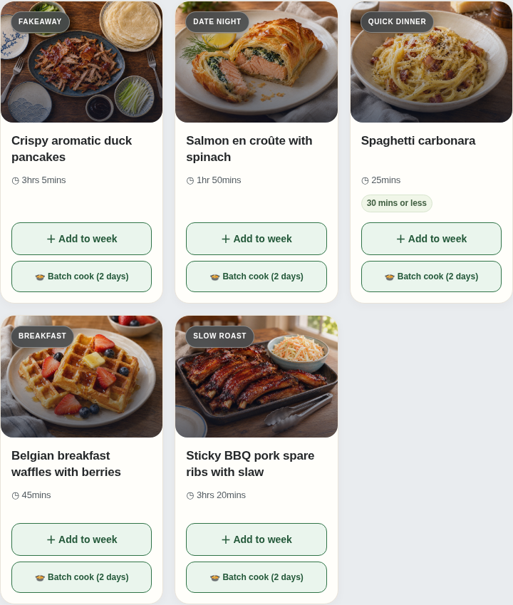

# Five-recipe visual and schema pilot

These are the first five staged recipes for the approved 200-recipe expansion. This directory is **not an active catalogue**, and its manifest explicitly sets `activationEligible:false`. The existing 100 Free and protected 400 Premium recipes, their normalizations, images, API response counts and installed clients remain unchanged. A complete 700 release still needs 195 further recipes and the versioned client/API integration.

| Number | Recipe | Access | Photograph |
|---:|---|---|---|
| 501 | Crispy aromatic duck pancakes | Premium | Overhead family-sharing platter; blue ceramics and patterned side plates |
| 514 | Salmon en croûte with spinach | Premium | Angled pastry cross-section on a cream plate |
| 527 | Spaghetti carbonara | Free | Close pasta-bowl view |
| 528 | Belgian breakfast waffles with berries | Premium | Angled breakfast plate |
| 545 | Sticky BBQ pork spare ribs with slaw | Free | Low-angle family tray, blue slaw bowl and serving tongs |

All five image fields retain the existing slug-based paths. Their files are isolated under `assets/`, mirroring those paths, until the complete versioned release materializes them into the live asset tree. This preserves the existing 500-release tooling’s exact 400-image check. They use the exact **1448 × 1086 WebP** format. Each has a unique SHA-256 and a hash-bound visual review. The photography policy calls for varied angles, tableware and occasional cutlery, while keeping the visible food faithful to the recipe. Source pictures were generated; file export changes only the encoding, with no cropping or resizing.

The two Free recipe objects and their aligned normalized ingredients are present here. The three Premium records, normalizations and full image briefs are encrypted in `.github/private-catalogue/catalogue700-pilot.sealed.json` using the existing recipient. No activation workflow consumes that pilot envelope. Full Premium recipes are not published as plaintext.

## Validation and release boundaries

The complete automated suite passed **3,078 tests with zero failures**, retaining one existing Swift-only skip and two existing Paddle TODOs. The old native bundle still packages exactly 100 Free recipes and no private payload; the pilot assets are excluded from that bundle. Nine new public pilot regressions and eighteen owner-side schema/negative checks passed.

- Existing `[name, quantity text, price, category]` ingredient arrays, positional normalized records, matching `method`/`steps`, portion/time/allergen metadata and image conventions are retained.
- All 120 actual source-aware pricing cases and 15 measured pantry cases passed. Estimates remain **indicative and unverified**. The two additional pack guides are staged separately and have not changed the production food/price catalogue; raw bone-in ribs remain distinct from generic pork or cooked meat.
- All 500 existing dinner classifications remain unchanged under both the old policy and the staged 700 policy. Breakfast stays excluded from dinner Auto-Fill.
- The legacy heuristic excludes any duck-pancake title. `tools/catalogue700/planning.mjs` introduces an explicit, opt-in 700 role policy for that new dish while preserving every old recipe. **It is not wired into the current app or native bundle**; the future 700 client must deliberately adopt it.
- Actual Discover previews at 390/880/1024px and the optional waffle Planner row loaded all five images, with no page/console errors or horizontal overflow. Their API fixtures still served the original complete 500 catalogue; pilot records and staged price guides were inserted only in browser memory. This is image/client-layout proof, not a deployed 505 or 700 release.
- No cooking tests, observed retailer-price verification, live import, API/table activation or native release is claimed. Existing review/provenance markers remain honest.

The read-only authoring verifier is `tools/catalogue700/verify-pilot.mjs`. Provide the owner-only 400-row baseline through `BB_RECIPE700_BASELINE_FILE`, and supply combined private authoring inputs through its `--recipes`, `--normalized`, `--image-briefs`, `--planning-roles`, `--pack-additions`, `--naturalness-review`, `--image-root catalogues/700/pilot/assets` and `--out` arguments. Keep those plaintext inputs/reports outside the public repository; `.local-private/` is ignored for that purpose. `validation-summary.json` contains public counts and hashes rather than Premium ingredient/method details.
