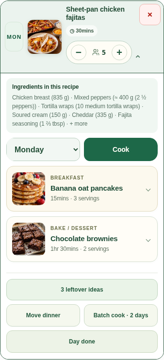

# Optional breakfast, compact extras and reversible Day Done

This change is based on baseline cleanup commit `422dbdb0da257e5fab71e79bfd0e4157bf6e2970` (PR #91). It does not expand or replace the recipe catalogue.

## Planner behavior

- Every day offers optional **Add breakfast** and **Add bake / dessert** actions. Breakfast opens a searchable breakfast/brunch-only picker. The current 500-recipe bank contains eleven breakfasts: six Free and five Premium. Access checks remain authoritative; no new recipe data is included.
- Breakfast and dessert use compact, clearly labeled rows with small thumbnails, time, portions and expandable controls. Their servings are independent of dinner and of the same breakfast planned on another day.
- Moving/removing extras, saving/loading weeks and reopening the app preserve their quantities. Ingredients enter the existing canonical shopping and cost paths; individual Cook and Day Done use those same portions.
- Dinner Auto-Fill remains dinner-only. Both manual and restored legacy batch plans preserve optional meals on their linked leftover days; only the source dinner doubles.
- Confirmed extras retain their recorded portions/day. Dinner-context Cook explicitly selects dinner when an older plan contains the same recipe in another meal slot.
- Planner actions use the existing forest-green/cream palette, consistent touch targets and a balanced layout. The unused second dinner-controls grid row is removed.

## Day Done and Undo

Double-tapping the day badge opens review. It cannot mark the day complete or deduct stock without explicit confirmation.

New Day Done confirmations journal exact physical-source and Kitchen quantity deltas and the meal receipts created by that action. **Undo day done** restores only those deltas, retains earlier individual Cook confirmations and later purchases/cooks, and cannot credit twice. Source allocations are independently recorded in Cook receipts and checked against the journal. Corrupt, duplicated, inconsistent or changed package/lot identities fail closed.

Old confirmations without this journal, changed food identities and already-confirmed dependent leftovers require review. Undo does not guess a replacement quantity or reset purchase/receipt replay history. Account, session, plan, pantry and receipt-projection changes invalidate stale previews. Final sync outcomes remain visible even when the planner rerender closes the original dialog.

An acknowledgement of identical physical pantry stock now preserves existing Kitchen metadata when owner and scope match. Actual remote changes, receipt imports, initial ownership adoption and unit-key rebasing retain their original projection behavior.

## Older-client cloud compatibility

The legacy `basketboss_data` table and its three-column contract remain unchanged. Older clients can replace its whole JSON value and drop unknown breakfast fields, so optional meals and per-slot portions also have a separate versioned backup:

- Installer: `sql/basketboss-planner-extras-v1.sql`.
- Table: `basketboss_planner_extras_v1`, keyed by Auth user and plan generation, with owner-only RLS and an Auth deletion cascade.
- RPC: `bb_save_planner_extras_v1`, `SECURITY INVOKER`, validated payloads and revision comparison before updates.
- Empty arrays are explicit deletion tombstones. Restore replaces the matching generation's extras rather than appending them. A new week cannot inherit a previous generation's breakfast backup.
- Restore stages the extension cache proposal into the existing atomic base-plan/Kitchen write. A failed restore cannot establish an unapplied extension revision.
- Unchanged uploads adopt an identical remote payload without writing. Conflicting edits require an explicit restore/review. Matching legacy base data still probes for protected extras and offers a deliberate restore choice if they differ.
- Missing setup or failed extension sync keeps local data and reports a partial backup; sign-in cannot overwrite that result with a full-success message. Unknown schema pauses repeated extension requests. The ordinary plan endpoint remains available.

The installer is prepared and tested, **not applied to production**. Install it before releasing the new client to provide the separate backup. Without it, breakfasts still save on the device and in exported plan files, while the UI reports that their protected cloud backup is unavailable.

## Validation

- Complete Node suite: **3,072 tests; 3,069 passes, zero failures, one existing Swift-only skip and two existing Paddle TODOs**.
- Strict pantry TypeScript checks pass with TypeScript 5.9.3, strict/checkJs/noEmit.
- Native web build and portable iOS verification pass: **939 files**, exactly 100 public Free recipes and no private recipe bundle. The three new planner dependencies are explicitly packaged. Verification now rejects missing local script/style dependencies even if the manifest's existing hashes are valid.
- Both app entry points remain identical. Recipe JSON, normalized ingredient data, pack catalogue, dessert data and the paired private 400-row snapshot are unchanged from the approved cleanup baseline.
- All 12,000 source-aware pricing comparisons retain their intended baseline behavior; all 2,000 direct normalized comparisons are unchanged. UK/US regional pantry audits have zero duplicate, non-canonical or conversion-failure rows.
- **13/13 frozen-source browser contexts passed** with zero page/console errors: eight existing regression contexts and five new planner contexts. They cover 320/390/768 px, independent portions, actual Shop/Cook quantities, repeated breakfast days, moves/removal, saved weeks/reloads, both batch paths and reversible Day Done with earlier Cook/later Finish Shop preservation. HTTP is intercepted with synthetic account data; no live account, billing, stock or AI writes occur.

Browser evidence is Chromium, not a physical iOS keyboard, StoreKit or production rollout claim. The earlier baseline's inconsistent native email-keyboard result and Cloudflare management inspection 401 remain separate release checks; this work does not label them passing.

## Release order

1. Review/merge the baseline cleanup dependency and this planner change.
2. Apply the additive extras installer and verify owner isolation, revision conflict handling and deletion behavior in the target environment.
3. Build/sync the native bundle and perform the Mac/device smoke checks before archiving the intended app version/build.
4. Release through the normal web/native process. The proposed 700-recipe catalogue remains a separate approved content/release task.
